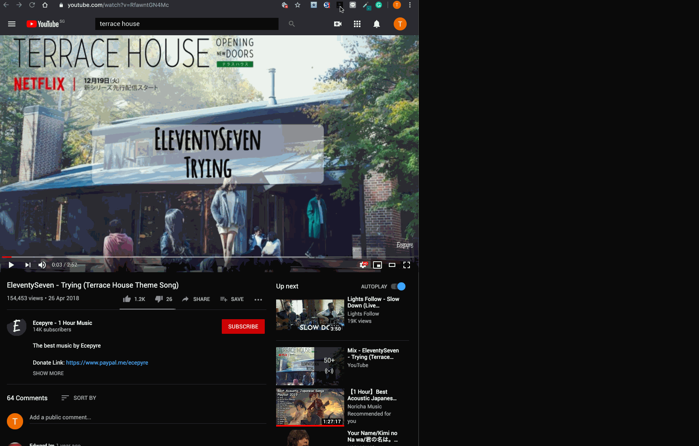

# MVP Playlist

## Overview
MVP Playlist is a Chrome extension built with React and Redux that lets you collect YouTube music videos into personal queues you can play from any computer after signing in. The extension opens a standalone player UI (`src/App.js`) that drives the experience with Material-UI controls and `react-chrome-extension-router` navigation between the login/register views (`src/pages/Login.js`, `src/pages/Register.js`) and the authenticated home screen (`src/pages/Home.js`). A hosted REST API at `https://mvp-playlist-server.herokuapp.com` (configured in `src/redux/utility.js`) handles authentication, user data, and persistence of songs and playlists.



## Key Features
- **Account management** – Users can register and log in through `LoginForm` (`src/components/forms/LoginForm.js`), which dispatches Redux actions in `src/redux/actions/authAction.js` to request tokens from the backend and stores them with helper utilities in `src/redux/utility.js`.
- **Song library** – Once authenticated, the `Navbar` component (`src/components/Navbar.js`) loads the current user via `src/redux/actions/userAction.js` and surfaces dialogs for browsing (`src/components/lists/SongList.js`), adding (`src/components/forms/AddVideoForm.js`), editing (`src/components/forms/EditVideoForm.js`), and deleting songs (`src/components/controls/Delete.js`). Playback is powered by the `CurrentSong` player (`src/components/CurrentSong.js`), which streams YouTube videos with transport controls (`src/components/controls/*.js`).
- **Playlist management** – Users can create (`src/components/forms/AddPlaylistForm.js`), edit (`src/components/forms/EditPlaylistForm.js`), and remove playlists through Redux flows defined in `src/redux/actions/playlistAction.js`. The `CurrentPlaylist` view (`src/components/CurrentPlaylist.js`) keeps track of the active playlist, plays its videos, and uses `SelectPlaylist` (`src/components/controls/SelectPlaylist.js`) to choose playlists, add existing songs to them (`src/components/lists/AddSongsList.js`), and review playlist contents (`src/components/lists/PlaylistSongsList.js`).
- **Chrome extension integration** – The manifest in `public/manifest.json` wires the React bundle into a Chrome extension. Background logic (`background/background.js`) adds a context-menu shortcut so you can right-click any page and send its title and URL into local storage. The UI polls that storage inside `AddVideoForm` to pre-fill the add-song dialog, enabling quick capture of the tab you were viewing.
- **State synchronization** – Redux reducers in `src/redux/reducers/*.js` centralize auth, user, song, and playlist state, while components such as `CurrentSong` and `CurrentPlaylist` coordinate with `localStorage` so that playback controls, context-menu additions, and dialogs stay in sync even when they are opened in separate extension windows.

## Project Structure
- `src/` – React application source code (pages, components, Redux store, and service worker setup).
- `background/` – Background script that powers the Chrome context menu and popup handling.
- `content-script/` – Content script placeholder that can be expanded for page-level integrations.
- `public/` – Static assets, including `manifest.json` and extension icons.
- `images/` – Reference imagery and GIFs demonstrating the UI.
- `scripts/` – Custom Create React App scripts for starting, building, testing, and watching the project.

## Getting Started
1. **Install dependencies**
   ```bash
   npm install
   ```
2. **Run the development build** (serves the React app with hot reloading):
   ```bash
   npm start
   ```
   This runs `scripts/start.js` and is useful while iterating on the UI. The API base URL already targets the live backend, so you can log in immediately.
3. **Create a production build for Chrome**:
   ```bash
   npm run build
   ```
   The optimized bundle appears in `build/` alongside the generated `manifest.json` and static assets.
4. **Load the extension in Chrome**
   - Open `chrome://extensions/`.
   - Enable **Developer mode**.
   - Click **Load unpacked** and select the `build/` directory (ensure it contains the manifest and background script).
   - The extension icon will appear in the toolbar; click it to open the player.

## Configuration Notes
- The API base URL is defined in `src/redux/utility.js`. To point the extension at a different backend (for example, a local instance of the server found at `https://github.com/reshinto/mvp_playlist_server`), update the exported `db` constant and rebuild the project.
- Authentication tokens and playback metadata are stored in `localStorage` so the background page, popups, and UI components can share state. Clearing your browser storage will sign you out and reset the player state.

## Available Scripts
- `npm start` – Launches the development server.
- `npm run build` – Produces a production-ready build for packaging as a Chrome extension.
- `npm test` – Runs the Jest test suite via `scripts/test.js` (no tests are currently defined in `src/`).
- `npm run watch` – Invokes the custom watch script defined in `scripts/watch.js`.

## Related Projects
- Backend API repository: https://github.com/reshinto/mvp_playlist_server (Node.js, Express, PostgreSQL service used by this extension).

## License
This project is released under the MIT License. See `LICENSE` for details.
